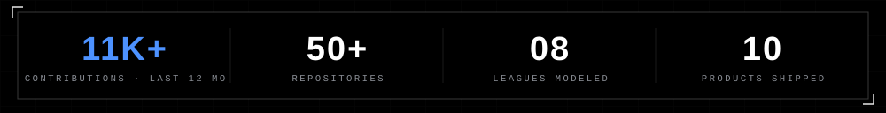
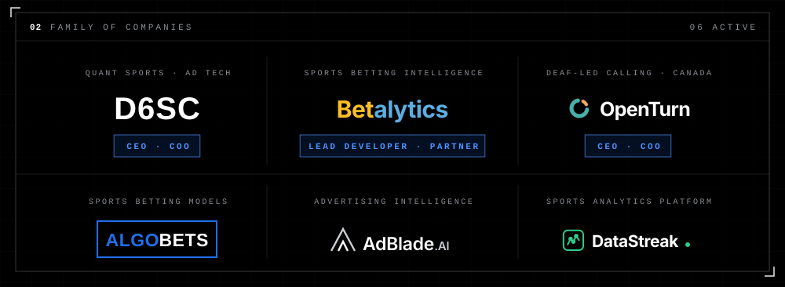
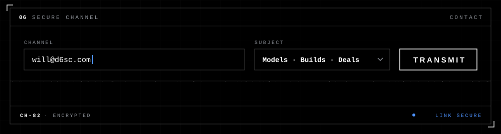

 

 

I'm **Will**, aka **Westie**. I run two companies as CEO and COO, **[Deep Six Sports Consulting](https://d6sc.com)** and **[OpenTurn](https://openturn.ca)**, and I'm lead developer and partner at **[Betalytics](https://www.betalytics.com)**. I still write the code myself.

On the betting side, I build sports models and the machines that ship them: scrapers and ETL that grab odds, lineups, injuries and weather the moment they move; models that score every line on the board; and the web apps, mobile clients and Discord bots that put the edge in front of bettors before the number moves.

Off the board, OpenTurn is my Deaf-led company taking the relay operator out of phone calls. You type, they hear a natural voice. They talk, you read live captions. Just you and the person you called.

Python and TypeScript. FastAPI and Next.js. Postgres and Redis. Everything ships to production, and almost all of it is private: **11,000+ contributions in the last year**, nearly none of them public. The receipts are in prod.

> *Models over vibes. Ship it, measure it, beat the close.*

 

**[d6sc.com](https://d6sc.com)** &nbsp;·&nbsp; **[betalytics.com](https://www.betalytics.com)** &nbsp;·&nbsp; **[openturn.ca](https://openturn.ca)** 
**[algo-bets.com](https://algo-bets.com)** &nbsp;·&nbsp; **[adblade.ai](https://adblade.ai)** &nbsp;·&nbsp; **[datastreak.com](https://datastreak.com)**

 

| | SYSTEM | WHAT IT DOES | STACK | STATUS |
|:-:|:--|:--|:--|:-:|
| `01` | **[Betalytics](https://www.betalytics.com)** | **Lead developer & partner.** Sports betting intelligence: 17+ analytics tools across 6 major sports, no-vig market odds, props, trends, matchup and NFL scheme analysis, backed by league model simulators and shipped to the App Store | `Python` `XGBoost` `Astro` `AWS · SST` |  |
| `02` | **[OpenTurn](https://openturn.ca)** | **CEO / COO.** Phone calls for Deaf and hard-of-hearing people with no operator in the middle: type and they hear a natural voice, they talk and you read live captions. Deaf-led, piloting on Android in Canada | `Android` `Twilio` `Deepgram` `ElevenLabs` |  |
| `03` | **[DataStreak](https://datastreak.com)** | Multi-sport betting analytics with 35+ edge surfaces: streaks, injury impact, line moves, alt lines, bounce-back spots | `Expo` `React 19` `FastAPI` `Postgres` |  |
| `04` | **[AlgoBets](https://algo-bets.com)** | Next-gen betting algorithms. ML-driven predictions and real-time analytics | `Python` `ML models` `Real-time` |  |
| `05` | **[AdBlade AI](https://adblade.ai)** | AI marketing command center. Paste a URL and get ad variants, landing pages and live Meta campaigns, with winners auto-scaled and fed back through RAG | `Python` `Claude` `Vector DB` |  |
| `06` | **[The Cover](https://thecover.bet)** | Sports news and betting tools. Next.js + Payload CMS front end, odds-polling worker and sportsdata ETL behind an Nginx load balancer | `Next.js` `Payload` `Redis` `Docker` |  |
| `07` | **[SportDataIQ](https://sportdataiq.com)** | Discord sports bot for 6 leagues: live scores, scoring alerts, Pick'em and daily "Edges of the Day" from DataStreak | `TypeScript` `Discord` `Vitest` |  |
| `08` | **[GoogMeetSlack](https://gmslack.com)** | `/meet 3pm tomorrow` in Slack books a Meet on your own calendar, then posts the AI-summarized transcript back to the thread | `FastAPI` `asyncpg` `Stripe` |  |
| `09` | **[Sheets](https://sheets.d6sc.com)** | 7-league perfect-streak tracker and auto parlay builder with line-movement tracking and Google Sheets export | `Flask` `pandas` `Google API` |  |
| `10` | **[AirYardIQ](https://airyardiq.d6sc.com)** | NFL opportunity analytics: WOPR, air-yard share, RACR, aDOT | `Flask` `pandas` |  |
| `11` | **Kalshi Execution Engine** | Sub-second order execution on NHL prediction markets: one trigger fires 10 to 15 IOC orders across moneyline, spread and totals | `TypeScript` `BullMQ` `Redis` `WebSockets` |  |
| `12` | **EdgeConf** | Live betting calls spoken, transcribed in real time with Whisper, and turned into structured tickets for trading teams | `Flask-SocketIO` `faster-whisper` `Postgres` |  |

**ALSO IN THE VAULT** &nbsp;·&nbsp; MLB Terminal (live xwOBA, wRC+ and Barrel% over WebSockets) · Bullpen Tracking System (reliever fatigue into edges) · Overwatch NBA (Discord bot with live DraftKings props) · ParlayPro (parlay finder across the sportsbooks) · HitBuddy MLB (hit-streak picks, PWA + Android) · FIFA World Cup Data (497K play-by-play events since 1930) · Overcast MLB weather pipeline

 

 

<picture>
  <source media="(prefers-color-scheme: dark)" srcset="https://raw.githubusercontent.com/westie-will/westie-will/output/snake-dark.svg"/>
  <source media="(prefers-color-scheme: light)" srcset="https://raw.githubusercontent.com/westie-will/westie-will/output/snake-light.svg"/>
  
</picture>

 

